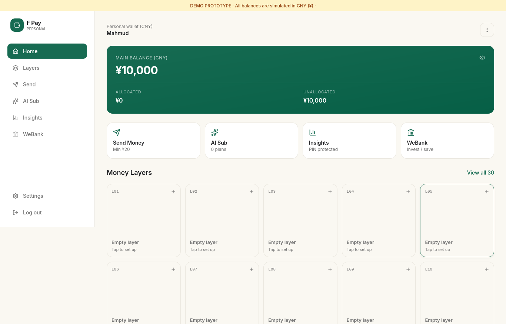

# F Pay — A Protective Digital Wallet Framework

### Your Money. Your Control. Your Security. fffgggh

<p align="center">
  <strong>Organize Money · Understand Transactions · Improve Financial Security</strong>
</p>

<p align="center">
  
</p>

F Pay is a security-oriented digital wallet prototype exploring how structured money management, purpose-aware budgeting, transaction risk awareness, and user-controlled security workflows can work together in a unified financial interface.

The project began as a lightweight prototype built with HTML, CSS, JavaScript, and Python. For the next development phase, we propose evolving it into a modular application with a modern frontend, a dedicated backend, transaction assessment services, and an optional permissioned blockchain and privacy-preserving technology layer.

> **Project status:** Phase 1 — Prototype developed. Phase 2 — Proposed architecture and planned development.

---

## Table of Contents

1. [Project Overview](#1-project-overview)
2. [The Problem](#2-the-problem)
3. [Our Proposed Solution](#3-our-proposed-solution)
4. [Core Innovation: The 30-Layer Money Management Model](#4-core-innovation-the-20-layer-money-management-model)
5. [Key Features](#5-key-features)
6. [Phase 1: Initial Prototype](#6-phase-1-initial-prototype)
7. [Phase 2: Proposed System Architecture](#7-phase-2-proposed-system-architecture)
8. [Planned Technology Stack](#8-planned-technology-stack)
9. [Transaction Workflow](#9-transaction-workflow)
10. [AI Sub: Purpose-Aware Budget Intelligence](#10-ai-sub-purpose-aware-budget-intelligence)
11. [Security and Privacy by Design](#11-security-and-privacy-by-design)
12. [Decoy and Sandbox Mode](#12-decoy-and-sandbox-mode)
13. [Phase 2 Development Roadmap](#13-phase-2-development-roadmap)
14. [Testing and Evaluation](#14-testing-and-evaluation)
15. [Current Limitations](#15-current-limitations)
16. [Future Vision](#16-future-vision)
17. [Research References](#17-research-references)
18. [Project Information](#18-project-information)

---

## 1. Project Overview

Digital wallets make payments faster and more accessible. However, users can still encounter unexpected expenses, unauthorized access, misleading transaction requests, financial fraud, and situations in which they are pressured to transfer money.

Most wallet experiences primarily focus on balance visibility, payment execution, and transaction history. Budgeting, security monitoring, and transaction-context review may be provided through separate tools or provider-specific features.

**F Pay explores a more integrated approach.**

Its proposed framework combines virtual money organization, spending-plan comparison, transaction risk awareness, and security-focused review workflows to help users make more informed financial decisions.

The system is organized around three principles:

- **Organize:** Structure available funds into purpose-based virtual money layers.
- **Understand:** Compare proposed transactions with relevant spending plans and contextual information.
- **Protect:** Provide appropriate security checks and review opportunities before a transaction proceeds.

F Pay is currently a prototype and system-design project. Its longer-term objective is to investigate how these capabilities could be implemented in a secure, scalable application.

## 2. The Problem

### 2.1 Limited purpose-based money organization

When users see a single wallet balance, it may be difficult to understand how much money is intended for education, transportation, subscriptions, savings, emergencies, or other purposes.

### 2.2 Unexpected or unplanned spending

A transaction can be technically valid but still conflict with the user's financial plan.

For example, a user may have planned to spend ৳500 on a subscription but initiate a transaction for ৳1,000.

### 2.3 Limited transaction-context awareness

A transaction's amount alone may not provide enough information to determine whether it deserves additional review. Its purpose, the user's saved plans, and relevant historical context may also matter.

### 2.4 Security challenges involving unauthorized or pressured transfers

Financial security involves more than password or PIN verification. An attacker may obtain credentials, and a user may enter valid credentials while under pressure.

These situations require careful treatment because unusual behaviour does not automatically prove fraud or coercion.

### 2.5 Fragmented financial tools

Money organization, budgeting, account security, and transaction monitoring are distinct functions. F Pay explores bringing them together in one modular workflow.

---

## 3. Our Proposed Solution

F Pay introduces a protective layer around the digital wallet experience.

Instead of treating a wallet solely as a balance and payment interface, the proposed design adds structured money management and transaction-context review.

### The F Pay approach

1. Organize money into 20 user-configurable virtual layers.
2. Allow users to define spending plans for relevant purposes.
3. Compare proposed transactions against applicable plans.
4. Identify selected discrepancies or risk indicators.
5. Present a review warning when appropriate.
6. Record the relevant activity in a controlled and auditable workflow.

The goal is not to claim that every fraudulent transaction can be identified. The goal is to investigate whether better financial organization and contextual review can improve user awareness and support safer decisions.

---

## 4. Core Innovation: The 20-Layer Money Management Model

The 20-layer virtual money model is one of F Pay's central design elements.

It allows a user to divide a wallet's available balance into logically separate allocations, each associated with a purpose.

These layers are not separate bank accounts. They are virtual allocations within the proposed wallet system.

### Example: 20 Virtual Money Layers

| Layer | Example purpose |
|---|---|
| 01 | Daily Essentials |
| 02 | Food and Groceries |
| 03 | Transportation |
| 04 | Education |
| 05 | Internet and Mobile |
| 06 | Subscriptions |
| 07 | Health and Wellness |
| 08 | Emergency Reserve |
| 09 | Personal Savings |
| 10 | Family Support |
| 11 | Shopping |
| 12 | Entertainment |
| 13 | Skill Development |
| 14 | Technology |
| 15 | Travel |
| 16 | Bills and Utilities |
| 17 | Gifts and Donations |
| 18 | Future Goals |
| 19 | Business and Projects |
| 20 | Custom Purpose |

These are illustrative labels. Users should be able to customize their layer names and intended purposes.

### How the model is intended to work

- The user views the main wallet balance.
- The user allocates available funds to selected virtual layers.
- The system tracks each layer's allocation.
- Sensitive operations require appropriate authentication and server-side authorization.
- The user can review the relationship between spending plans, layer allocations, and proposed transactions.

A future implementation must enforce balance consistency and prevent spending the same funds more than once.

The 20-layer model is the current prototype's design scope. Supporting hundreds of configurable layers is a potential future scalability objective, not a completed capability.

---

## 5. Key Features

### 5.1 Virtual Money Management

A purpose-based interface for organizing funds into separate logical allocations.

### 5.2 Transaction Risk Awareness

A proposed assessment layer that can evaluate defined transaction indicators and flag activity requiring further review.

Risk assessments should communicate uncertainty and must not treat every unusual transaction as fraudulent.

### 5.3 AI Sub — Smart Budget Assistant

A planned budgeting component that lets users define spending plans and compare proposed expenses against those plans.

### 5.4 Pre-Transaction Review

A warning interface for relevant budget discrepancies or selected risk indicators before the user proceeds.

In a standalone prototype, this is a simulated review workflow. Preventing a real payment requires control over the payment execution process through an authorized financial service provider.

### 5.5 Authentication and Recovery

A security-oriented access workflow involving PIN-based access, demonstration-level OTP verification, and recovery options.

Production deployment would require stronger credential handling, abuse prevention, secure recovery procedures, and independent security review.

### 5.6 Activity Records

A structured record of relevant actions and simulated transactions. A future backend can provide stronger validation and access-controlled audit records.

### 5.7 Isolated Sandbox Experience

A separate demonstration environment for exploring decoy or sandbox interactions without executing real payments.

---

## 6. Phase 1: Initial Prototype

**Status: Prototype developed**

The first phase focused on translating the core idea into a demonstrable application without requiring a full financial-services infrastructure.

### Technology used

- HTML — application structure
- CSS — interface styling and layout
- JavaScript — client-side interactions
- Python — used within the prototype development context

### Phase 1 objectives

- Establish the basic F Pay concept.
- Demonstrate the wallet interface.
- Represent the 20-layer money-management model.
- Explore the proposed access and transaction workflows.
- Demonstrate how budgeting and transaction review could fit into the user experience.
- Create a foundation for the next development phase.

### What Phase 1 represents

Phase 1 is the initial prototype, not a production-ready digital wallet.

The existence of a demonstration interface does not by itself establish that backend authorization, secure financial storage, real OTP delivery, payment processing, blockchain integration, or reliable fraud detection has been implemented.

Any feature presented during a demonstration should be identified according to its actual implementation status.

### Why we chose a lightweight prototype first

Building a lightweight prototype allowed us to explore the user experience and validate the general workflow before committing to a more complex architecture.

This approach also creates a clearer development path: preserve the useful interface and product concepts, then introduce stronger backend controls and modular services where they provide measurable value.

---

## 7. Phase 2: Proposed System Architecture

**Status: Planned — subject to implementation and testing**

Phase 2 aims to evolve F Pay from a lightweight prototype into a modular application with clearly separated responsibilities.

The proposed architecture contains three primary layers.

### Layer 1 — Frontend and User Experience

**Proposed technologies:** React or Next.js, Tailwind CSS

Responsibilities:

- Wallet dashboard and main balance view
- 20-layer money-management interface
- Layer allocation and review screens
- Transaction creation and confirmation interfaces
- Budget plans and AI Sub analytics
- Security warnings and access workflows
- Sandbox and demonstration interface

The frontend will communicate with the backend through validated API requests.

Security-critical decisions must not rely exclusively on client-side JavaScript.

### Layer 2 — Backend, AI and Logic Middleware

**Proposed technologies:** Python, FastAPI, relational database

Responsibilities:

- User authentication and authorization
- Server-side layer allocation and balance validation
- Transaction request validation
- Expense categorization and budget comparison
- Configurable transaction-risk assessment
- Review and warning workflow
- Activity records and audit logging
- Controlled integration with external services

The backend acts as the central coordination layer.

It receives requests, validates permissions, evaluates applicable rules, and determines which operations the application is permitted to perform.

### Layer 3 — Blockchain and Privacy Technologies

**Technologies under evaluation:** FISCO BCOS, Solidity smart contracts, selected WeDPR components where suitable

Potential responsibilities:

- Verifiable records for selected events
- Integrity references for audit purposes
- Permissioned blockchain experiments
- Privacy-preserving processing for suitable use cases
- Evaluation of whether blockchain provides measurable value over a conventional database

Not every transaction or personal financial record needs to be stored on-chain.

Sensitive personal information should generally remain in appropriately protected off-chain storage. Only carefully selected, justified records or cryptographic references should be considered for on-chain publication.

Blockchain integration is a proposed research and engineering direction, not a completed Phase 1 feature.

### Proposed Architecture Diagram

```text
┌──────────────────────────────────────────────┐
│          LAYER 1: FRONTEND & UX               │
│                                              │
│  React / Next.js / Tailwind CSS              │
│  • 20-Layer Wallet Dashboard                 │
│  • Budget Plans & Transaction Review         │
│  • Security Alerts & Sandbox UI              │
└──────────────────────┬───────────────────────┘
                       │
                 HTTPS / JSON
                       │
                       ▼
┌──────────────────────────────────────────────┐
│       LAYER 2: BACKEND & LOGIC               │
│                                              │
│  Python / FastAPI                            │
│  • Authentication & Authorization            │
│  • Wallet & Layer Management                 │
│  • Budget Comparison                         │
│  • Transaction Risk Assessment                │
│  • Audit Logging                             │
└───────────────┬───────────────────┬──────────┘
                │                   │
                ▼                   ▼
┌────────────────────────┐  ┌──────────────────┐
│  RELATIONAL DATABASE   │  │ REVIEW WORKFLOW  │
│                        │  │                  │
│  Users & Allocations   │  │ Warnings         │
│  Plans & Transactions  │  │ Confirmation     │
│  Audit References      │  │ Status Tracking  │
└────────────────────────┘  └─────────┬────────┘
                                      │
                                      ▼
                         ┌────────────────────────┐
                         │ OPTIONAL BLOCKCHAIN    │
                         │ & PRIVACY INTEGRATION  │
                         │                        │
                         │ FISCO BCOS             │
                         │ Solidity Contracts     │
                         │ Selected WeDPR Tools   │
                         └────────────────────────┘
```

This is a proposed logical architecture. The final component boundaries and integration methods will be determined through compatibility testing and implementation.

---

## 8. Planned Technology Stack

| Component | Proposed technology | Purpose |
|---|---|---|
| Frontend | React or Next.js | Interactive application interface |
| Styling | Tailwind CSS | Consistent, responsive UI |
| Backend | Python and FastAPI | APIs and application logic |
| Database | PostgreSQL | Structured application data |
| API format | REST and JSON | Communication between frontend and backend |
| Risk assessment | Rules engine first; ML evaluated later | Explainable transaction review |
| Smart contracts | Solidity, where supported | Selected on-chain logic |
| Blockchain | FISCO BCOS, subject to compatibility validation | Permissioned blockchain experiments |
| Privacy technology | Suitable WeDPR components, if justified | Privacy-preserving computation experiments |
| Testing | Automated API, security, and integration tests | Verify correctness and reliability |
| Version control | Git and GitHub | Source control and project collaboration |

### Why these technologies?

**React or Next.js:** Suitable for building a modular interface with reusable components.

**FastAPI:** Provides a Python-based approach to building typed APIs and separating backend responsibilities.

**PostgreSQL:** Supports structured data, relational integrity, and transactional operations needed for consistent wallet allocations.

**Rules engine before machine learning:** Explicit rules are easier to explain, test, and validate during early development. Machine-learning components should be introduced only when suitable data, evaluation criteria, and a clear benefit are available.

**FISCO BCOS and WeDPR:** These technologies will be evaluated against specific requirements. They should be included only where compatibility, privacy, and operational benefits justify their complexity.

The stack is a proposal, not a claim that every listed component is already integrated.

---

## 9. Transaction Workflow

A typical proposed transaction-review workflow is:

1. The user enters a transaction request.
2. The frontend sends the request to the backend over a protected connection.
3. The backend validates the user's identity, permissions, and request data.
4. The system checks the relevant virtual allocation and available balance.
5. The budget component compares the transaction with the user's saved plan.
6. The assessment component evaluates configured risk indicators.
7. If a relevant discrepancy is identified, the system requests review or presents a warning.
8. The user reviews the information and chooses how to proceed, where the applicable workflow permits.
9. The backend records the outcome and maintains consistent application state.
10. If justified, a selected audit reference may be sent to a blockchain integration.

```text
Transaction Request
        |
        v
Authentication & Authorization
        |
        v
Request and Balance Validation
        |
        v
Budget and Risk Assessment
        |
        v
Review Required?
    /          \
   Yes          No
    |            |
    v            v
Review UI    Normal Workflow
    |            |
    +------+-----+
           |
           v
Authorized Outcome
           |
           v
Activity Record
           |
           v
Optional Verifiable Reference
```

This workflow describes the intended application design. A production system must define precise authorization, transaction-state, error-handling, and payment-provider integration rules.

A warning is not equivalent to a payment hold. Real payment enforcement requires the system to have authorized control over payment execution.

---

## 10. AI Sub: Purpose-Aware Budget Intelligence

AI Sub is the proposed budgeting and spending-analysis component of F Pay.

### Planned capabilities

- Create a spending plan with a title and amount.
- Associate a plan with a relevant virtual layer when appropriate.
- Configure reporting intervals, such as 7, 15, or 30 days.
- Compare a proposed transaction with the relevant plan.
- Display budget discrepancies before confirmation.
- Summarize planned versus recorded spending.
- Explore more advanced analytics after the basic workflow is validated.

### Example

Suppose a user has created this plan:

| Field | Value |
|---|---|
| Purpose | Subscription |
| Planned amount | ৳500 |
| Proposed transaction | ৳1,000 |
| Difference | ৳500 above plan |

F Pay can identify that the proposed amount exceeds the saved plan and ask the user to review it.

This is a budget discrepancy, not proof of fraud.

### Planned implementation strategy

**Stage 1:** Deterministic budget comparisons and explainable rules.

**Stage 2:** Expense categorization and configurable contextual indicators.

**Stage 3:** Evaluation of machine-learning methods, if suitable data and measurable improvements justify them.

No trained AI capability or detection performance should be claimed until the corresponding component has actually been implemented and tested.

---

## 11. Security and Privacy by Design

Security is a core engineering requirement for F Pay, not merely a visual feature.

### 11.1 Authentication and authorization

A production implementation should use appropriately protected credentials, server-side permission checks, secure session handling, and rate limits for sensitive operations.

A PIN or OTP can help verify access, but valid credentials do not necessarily prove that a transaction is voluntary.

### 11.2 Balance integrity

The backend should enforce allocation constraints, prevent double spending within the application model, and use database transactions for operations that update balances.

### 11.3 API security

The application should validate input, enforce authorization for every sensitive operation, apply appropriate rate limits, and avoid exposing sensitive internal information through error messages.

### 11.4 Privacy-conscious data handling

The system should collect only the information necessary for its functions and define retention, access, and deletion policies.

Sensitive financial information should not be placed on a public or broadly replicated ledger without a strong, justified privacy design.

### 11.5 Auditability

Activity records can help investigate application errors and reconstruct selected operations. Audit access should be restricted and protected against unauthorized modification.

### 11.6 Fraud and coercion limitations

Unusual transaction behaviour may be legitimate, while a harmful transaction may look normal.

Any future risk assessment must be evaluated for false positives, false negatives, usability, and possible harm. Coercion-related protection requires specialized safety research and cannot be guaranteed by PINs, OTPs, or a simple risk score.

---

## 12. Decoy and Sandbox Mode

F Pay explores an isolated sandbox experience as part of its security-oriented design.

The purpose is to demonstrate a separate wallet-like environment with fictional balances and simulated transaction history.

### Design principles

- Clearly isolate sandbox state from real wallet state.
- Label the environment appropriately during testing and demonstrations.
- Prevent sandbox transactions from invoking real payment services.
- Ensure the backend enforces separation rather than relying only on the interface.
- Test whether switching between environments can expose or alter another environment's data.

A decoy interface should not be represented as a proven coercion-defense mechanism. A person applying pressure may still recognize or reject a decoy, and an unsafe intervention could create additional risk.

Any production implementation of a duress-related feature would require threat modelling, expert review, careful user research, and appropriate safety testing.

---

## 13. Phase 2 Development Roadmap

The second phase will prioritize a working, testable application before adding complex infrastructure.

### Stage 1 — Frontend Modernization

- Rebuild the prototype interface using React or Next.js.
- Implement reusable dashboard, layer, budget, and transaction components.
- Improve responsive layouts and accessibility.
- Preserve the 20-layer concept and relevant user workflows.

**Deliverable:** A modular frontend connected to defined application states.

### Stage 2 — Backend and Database

- Build API endpoints using FastAPI.
- Design a PostgreSQL schema for users, layer allocations, plans, and activity records.
- Implement authentication and server-side authorization.
- Add validation for allocation and transaction operations.
- Define transaction-state and error-handling behaviour.

**Deliverable:** A functioning application backend with persistent, validated data.

### Stage 3 — Budget and Transaction Assessment

- Implement budget comparison rules.
- Add configurable transaction-review indicators.
- Build clear warnings and review states.
- Record relevant outcomes for testing.
- Evaluate false alerts and ordinary user scenarios.

**Deliverable:** An explainable transaction-review workflow.

### Stage 4 — Security Hardening

- Test authentication and authorization boundaries.
- Add rate limits and appropriate monitoring.
- Verify allocation consistency and sandbox isolation.
- Review sensitive data handling.
- Perform API and application security tests.

**Deliverable:** A more robust prototype with documented test results.

### Stage 5 — Blockchain Feasibility and Integration

- Confirm FISCO BCOS version and SDK compatibility.
- Establish a local or permitted test environment.
- Define one specific use case for a smart contract.
- Evaluate the cost and operational complexity of on-chain records.
- Test whether selected records can be verified correctly.

**Deliverable:** A working blockchain proof of concept, if feasibility testing succeeds.

### Stage 6 — Privacy Technology Evaluation

- Identify a precise privacy requirement.
- Review suitable WeDPR components and their current documentation.
- Assess integration compatibility.
- Test the selected capability with synthetic or appropriately authorized data.
- Document performance and privacy trade-offs.

**Deliverable:** A tested privacy-preserving proof of concept, if justified and feasible.

### Stage 7 — End-to-End Evaluation

- Run normal, boundary, and failure scenarios.
- Evaluate budget-warning behaviour.
- Verify backend authorization.
- Test sandbox separation.
- Measure response time and system reliability.
- Document limitations and next steps.

**Deliverable:** An evaluated prototype and a reproducible demonstration.

---

## 14. Testing and Evaluation

F Pay's effectiveness should be measured through reproducible tests rather than assumed from its architecture.

| Test area | Example evaluation |
|---|---|
| Layer management | Verify allocations and balance consistency |
| Budget assessment | Check correct detection of planned-versus-proposed discrepancies |
| Authorization | Verify that unauthorized operations are rejected |
| Sandbox isolation | Confirm that sandbox actions cannot modify real payment state |
| API validation | Test malformed, incomplete, and unauthorized requests |
| Audit records | Check whether selected events are recorded consistently |
| Blockchain integration | Verify selected smart-contract operations and record references |
| Privacy component | Test the defined privacy use case and its limitations |
| Usability | Measure whether users understand warnings and review options |
| Performance | Measure response times under defined test conditions |

Any machine-learning component would additionally require suitable evaluation data, documented metrics, and analysis of false positives and false negatives.

No fraud-reduction rate, coercion-detection accuracy, or production security guarantee is claimed without appropriate evidence.

---

## 15. Current Limitations

F Pay remains a developing prototype and research-oriented system design.

Current limitations include:

- The initial prototype does not constitute a production payment service.
- Demonstration transactions do not move real money.
- A frontend warning cannot independently block payments in external wallet applications.
- The proposed modern frontend, production backend, database integration, and blockchain layer require implementation and testing.
- The usefulness of machine learning depends on appropriate data and validated performance.
- Coercion detection is an unresolved, difficult safety problem.
- Blockchain integration may add complexity without sufficient benefit unless a specific use case justifies it.
- Regulatory, operational, and security requirements would need to be addressed before any real financial deployment.

These limitations define the next engineering and research tasks rather than invalidate the project's overall direction.

---

## 16. Future Vision

The long-term vision is to explore a digital wallet framework that combines user-controlled financial organization with contextual transaction review and appropriately designed security controls.

Potential future directions include:

- Scalable virtual money management beyond the initial 20-layer design.
- Improved expense classification and spending analytics.
- More rigorous transaction-risk assessment.
- Carefully researched user-safety workflows.
- Verifiable records for selected operations.
- Privacy-preserving processing where there is a clear use case.
- Integration with authorized financial-service providers.
- Independent security, usability, and performance evaluation.

A larger layer count, advanced AI, blockchain-based verification, and real-time payment enforcement remain future objectives until each is implemented and validated.

---

## 17. Research References

The following sources provide background for relevant behavioural, security, authentication, and technical design decisions.

1. **Thaler, R. H. (1999).** “Mental Accounting Matters.” *Journal of Behavioral Decision Making, 12*(3), 183–206.  
   https://doi.org/10.1002/(SICI)1099-0771(199909)12:3%3C183::AID-BDM318%3E3.0.CO;2-F

2. **OWASP Foundation.** *Multifactor Authentication Cheat Sheet.*  
   https://cheatsheetseries.owasp.org/cheatsheets/Multifactor_Authentication_Cheat_Sheet.html

3. **OWASP Foundation.** *Forgot Password Cheat Sheet.*  
   https://cheatsheetseries.owasp.org/cheatsheets/Forgot_Password_Cheat_Sheet.html

4. **FastAPI Documentation.**  
   https://fastapi.tiangolo.com/

5. **PostgreSQL Documentation.**  
   https://www.postgresql.org/docs/

6. **FISCO BCOS Documentation and Source Code.**  
   https://github.com/FISCO-BCOS/FISCO-BCOS

7. **WeDPR Project.** Privacy-preserving computing technologies and related documentation.  
   https://github.com/WeBankBlockchain/WeDPR

8. **Bangladesh Bank.** Official website and applicable financial-services regulations.  
   https://www.bb.org.bd/

These references provide relevant background and technical documentation. They do not independently establish the novelty, security, or effectiveness of F Pay.

---

## 18. Project Information

**Project Name:** F Pay  
**Project Category:** FinTech · Digital Wallet Security · Financial Risk Awareness  
**Development Status:** Initial prototype developed; second-phase architecture proposed  
**Researcher:** Nahid Mahmud  
**Affiliation:** Department of Computer Science and Engineering, Varendra University, Bangladesh

### Project Philosophy

F Pay explores a simple idea:

**A digital wallet should help users understand and organize their money, not merely display a balance and process a transaction.**

By combining structured money management, budget awareness, and security-oriented transaction review, F Pay aims to investigate a more considered approach to digital financial interactions.

*F Pay — Your Money. Your Control. Your Security.*
